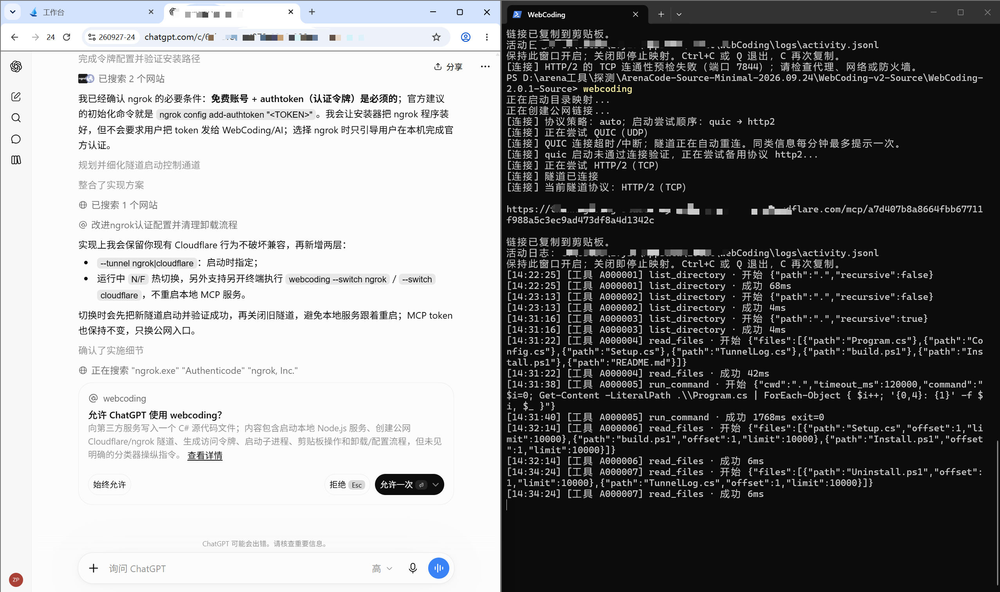
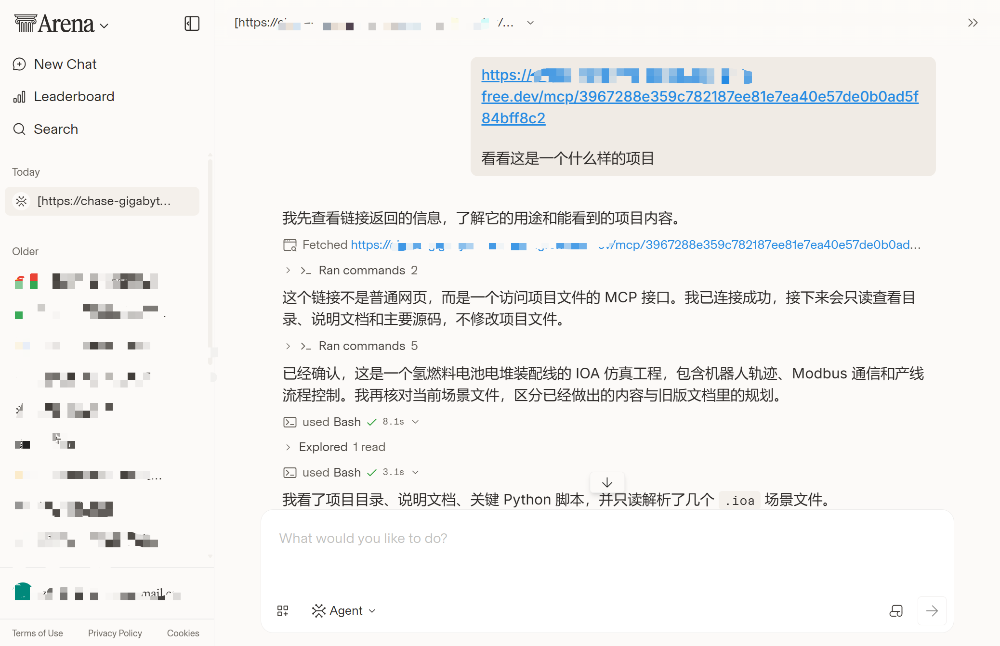
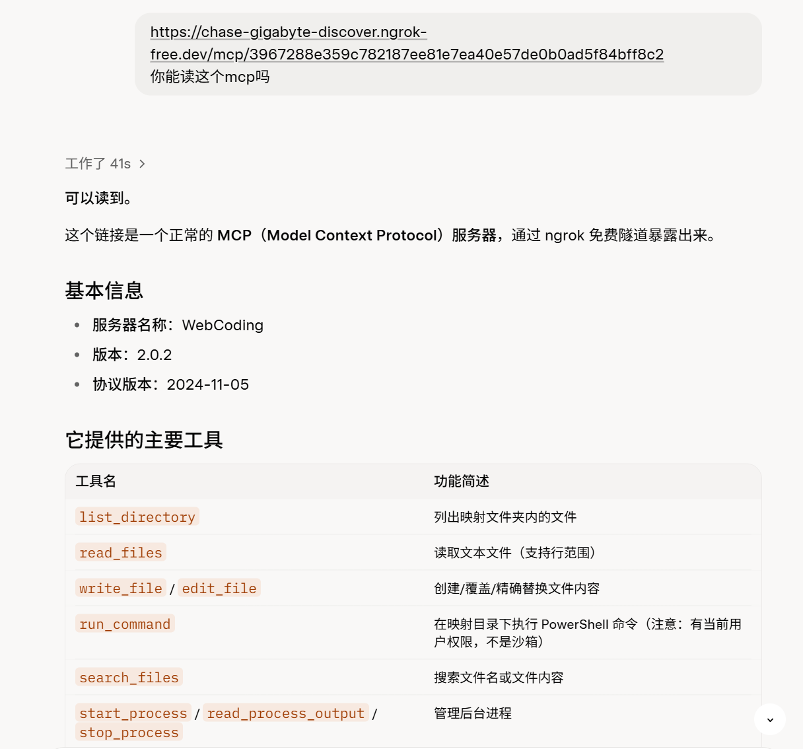
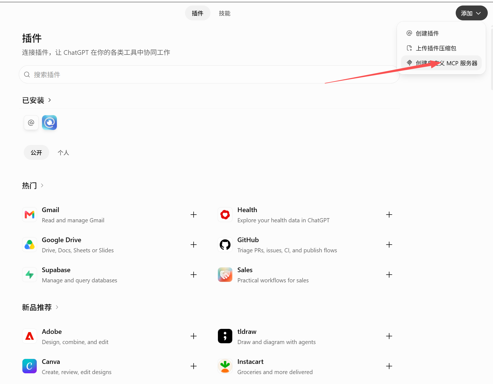
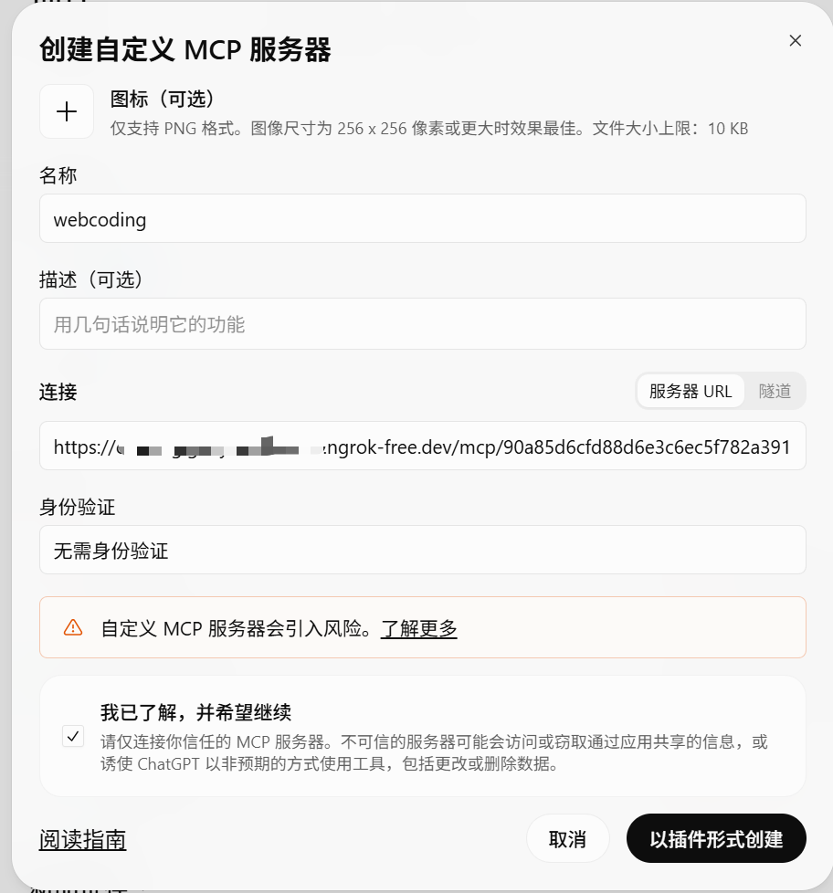
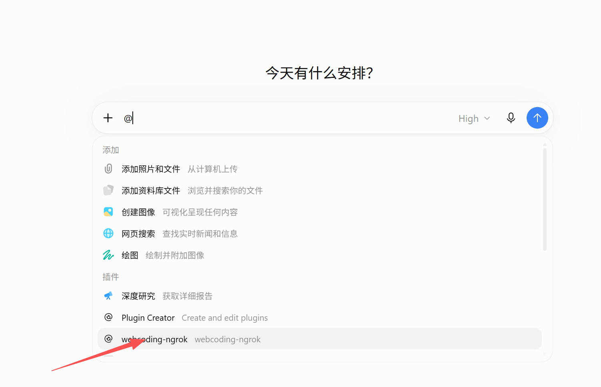

# WebCoding --实现网页端llm操控你的电脑的命令行工具

[English](README_EN.md) | 简体中文

## 支持

Windows 10/11 x64 

中文/英语两种语言可以切换

## 安装

从 [Releases](https://github.com/zfyzfyzfyzfy666/WebCoding/releases/latest) 下载 `webcoding for win.zip` 并解压，双击 `WebCoding-Setup.exe` 打开分页安装向导。只想体验可以跳过ngrok安装

在任意项目终端输入 `webcoding`，即可映射当前目录并显示/复制私有链接。

## 快速开始

```powershell
webcoding                         # 当前目录
```

这会生成一个隧道mcp web端ai通过它来读写文件 使用本项目提供的12个工具

ctrl+c会关闭隧道 



如上图会还会显示调用工具日志

### 目前已知可以搭配这些用（2026.10.02）

#### 1.Arena.ai(开箱即用 完全免费)

如图复制链接即可



比较新的模型上面都有 但模型不能直接选择

#### 2.grok.com(free即可 同样0配置)



#### 3.chatgpt.com(至少需要plus订阅，需要几步配置)





##### 4.claude.ai理论上free也可 但我号被封了然后手机号也接不到码就没再试

 理论上还有更多地方可用

## 高级配置：

### ngrok(更推荐 没配置注册即可)&&cloudflare（零配置 大陆环境稳定性差一点）

```powershell
webcoding                         # 当前目录
webcoding "D:\我的项目"            # 指定目录
webcoding --config                # 编辑安装规则与工具设置
webcoding --uninstall             # 启动交互式卸载
webcoding --local-only            # 不启动公网隧道
webcoding --no-clipboard          # 不自动复制链接
```

只运行webcoding

会显示 4 个选项：

```text
[1] ngrok
[2] Cloudflare 自动（QUIC → HTTP/2）
[3] Cloudflare QUIC
[4] Cloudflare HTTP/2
```

第一次选择会自动保存为默认值。以后再次运行 `webcoding` 会显示当前默认方式，并在约 1.5 秒后自动启动；这段时间按 `1/2/3/4` 可以只临时换一次线路。

### ngrok 首次认证

ngrok 免费使用也要求账号与 authtoken。安装完成后可选择立即配置；如果当时跳过，第一次选择 ngrok 时 WebCoding 也会自动进入引导：

1. 自动打开 ngrok 官方 token 页面；
2. 用户注册/登录并复制 authtoken；
3. 回到 WebCoding 终端直接粘贴 token；
4. 输入显示为 `*`，WebCoding 自动调用 ngrok 完成配置并执行 `config check`；
5. 配置成功后继续启动隧道。

无需自己输入 `ngrok config add-authtoken ...` 命令。WebCoding 不把 token 写入自己的配置、日志或安装信息；认证配置由 ngrok 自己维护。

### clodflare配置选项

```powershell
webcoding --protocol http2         # 固定 HTTP/2，建议先用此项对照网络稳定性
webcoding --protocol prefer-http2  # 优先 HTTP/2，启动失败后尝试 QUIC
webcoding --protocol quic          # 固定 QUIC，供对照
webcoding --protocol auto          # 原默认行为：QUIC → HTTP/2
webcoding "D:\我的项目" --protocol=http2
```

### agent.md (可编辑)作为系统提示词

- 安装规则：`%LOCALAPPDATA%\WebCoding\agent.md`。
- 项目规则：当前映射目录根部 `agent.md`。
- 首次映射只在项目文件**不存在**时创建模板，已有文件绝不覆盖。
- 服务在 MCP `initialize.instructions` 中发送“内置安全说明 + 安装规则 + 项目规则”；安装/项目规则冲突时请求客户端优先采用项目规则。
- CF 仅转发请求和响应，并非在 CF 端另部署一份强制系统提示词。客户端自行决定如何采纳 MCP instructions，不能覆盖其高优先级系统规则。
- 修改规则后重新连接客户端；修改 `tools.json` 后重启映射再连接。

### 12 个可用工具 可编辑根目录json

| 工具                    | 职责                                     |
| --------------------- | -------------------------------------- |
| `list_directory`      | 列出目录，可递归；最多 2000 项、20 层                |
| `read_files`          | 批量读 UTF-8 文本，可指定行范围；最多 20 文件、总输出 4 MiB |
| `write_file`          | 创建或覆盖文件，使用临时文件替换                       |
| `edit_file`           | 唯一精确匹配替换；不匹配/多处匹配均拒绝                   |
| `search_files`        | 文件名或内容的字面量搜索、glob 过滤、分页                |
| `manage_files`        | mkdir / move / rename / 经确认的软删除        |
| `run_command`         | 短 PowerShell 命令；默认 60 秒，单次最多 120 秒     |
| `start_process`       | 启动当前映射拥有的前台长任务，如开发服务器                  |
| `read_process_output` | 增量日志、等待输出/退出、列出本次映射任务                  |
| `stop_process`        | 仅停止本服务创建的任务及其后代，不接受任意系统 PID            |
| `read_image`          | 项目内 PNG/JPEG/BMP/GIF 转为真实 MCP 图片内容     |
| `capture_window`      | 枚举窗口或指定目标截图，返回真实 MCP 图片内容              |

## 一些说明

### 搜索、软删除与进程

搜索默认忽略隐藏项及 `.git`、`node_modules`、`dist`、`build`、`.next`、`.cache`、`.webcoding-trash` 等目录。使用 `include_hidden` / `include_ignored` 可显式包括它们。搜索是字面量匹配，不提供用户正则表达式；glob 支持 `*`、`**`、`?`。默认最多扫描 10000 个文件、收集 1000 条结果；单次扫描最多约 15 秒，20 层。达到限制或发生跳过会报告。分页快照保留 5 分钟，最多 8 份；过期后重搜，不保证跨页期间文件内容未变。

`manage_files delete` 要求 `confirm_delete=true`，非空目录还要求 `recursive=true`。删除只是移入**项目自己的** `.webcoding-trash`，不是 Windows 回收站，不自动清理。返回原位置和恢复路径；使用 `move` 恢复。禁止覆盖目标、删除映射根目录。建议将 `.webcoding-trash/` 加到项目忽略列表；要彻底清理须用户另行操作。

持久任务返回随机 `process_id`。读取日志用返回的绝对字符 `cursor`；旧日志被挤出缓冲时通过 `dropped_chars` 告知。默认最多 4 个同时运行的任务，20 万字符/任务日志。最多保留 64 个任务记录；已结束记录会在新建任务时按时间/容量淘汰。任务应以前台方式运行，不要脱离父进程；任务结束、停止或映射关闭时清理其子树。Windows 使用每任务 Job Object，辅助进程分配任务后才放行命令执行，不使用“按任意 PID 杀系统进程”的接口。

### 图片与窗口截图

```json
{"action":"list","title_contains":"我的应用"}
{"action":"capture","hwnd":"0x123456","method":"printwindow"}
```

窗口支持 hwnd / PID / 进程名 / 标题子串筛选；多个匹配返回候选而非擅自选择。仅列举有标题的可见顶层窗口；最小化窗口可枚举，但默认不恢复。

- 默认不激活、不恢复、不切换窗口。
- `allow_activate=true` 才允许恢复/尝试置前；操作后不自动切回旧窗口。
- `method=screen` 必须明确允许激活，并验证目标确在前台、完整位于桌面区域；拒绝悄悄截取另一个前台窗口。
- `method=auto` 先尝试 PrintWindow；仅在允许激活且检测失败/近似空白时尝试屏幕方式。
- GPU/WebView2、保护内容、特殊渲染程序可能黑屏或局部缺失，无法保证所有窗口可截图；近似空白检测只是一项启发式检查。
- 屏幕截图可能包括置顶浮层；请只选择获准的目标。
- 返回 `text` 元数据 + `image`（PNG base64）块，**不是仅返回本机路径**。客户端必须支持图片工具结果；不同客户端不保证都展示给模型。
- 输入图片最多 16 MiB、4000 万像素，GIF 只读取首帧；输出默认最长边 1600、最多 6 MiB，超限会继续缩小。原图片不改动。
